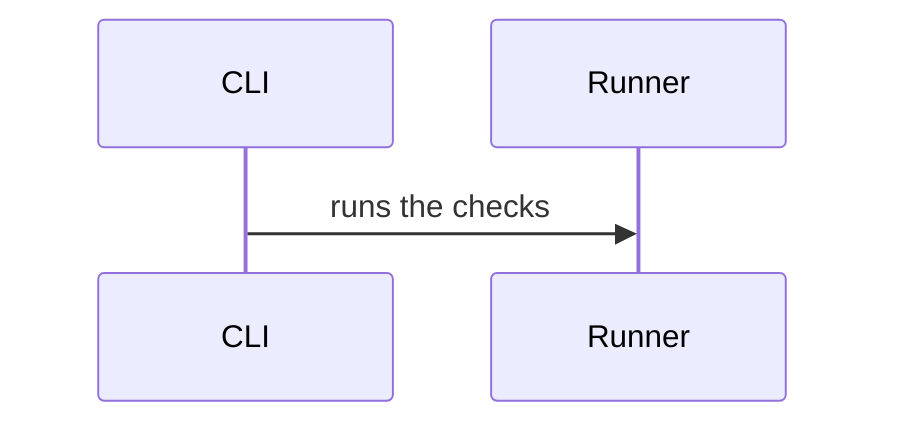

# slartiarch

<div align="center">
  
</div>

Slartibartfast: the architect. From *The Hitchhiker's Guide to the Galaxy*, the curmudgeonly designer of Norway's fjords — and the namesake of this tool.

slartiarch is a coordination CLI that checks consistency between architecture diagrams
([LikeC4](https://likec4.dev) or [Mermaid](https://mermaid.js.org)), [LinkML](https://linkml.io)
schemas, and [SHACL](https://www.w3.org/TR/shacl/) shapes.
It also regenerates the diagrams in your architecture document so the prose never drifts.

Each tool is useful on its own with no slartiarch involved. slartiarch adds the seams — rules that span
two tools, and checks that the answers still agree.

## Install

```bash
uv tool install slartiarch
npm install likec4   # only for projects that keep a LikeC4 model
```

Node and LikeC4 are needed only when the project has `*.c4` sources. Without them,
`slartiarch doctor` reports both as not required, and `check` and `docs` run with `uv` alone.

## Use

```bash
slartiarch init          # scaffold docs/slarti/ and a config (vocabulary instances)
slartiarch init --likec4 # scaffold a LikeC4 model instead (needs Node)
slartiarch doctor        # resolved paths and tool versions
slartiarch check         # run all validations, stale docs included (CI command)
slartiarch check --json  # structured output for automation
slartiarch check --fix   # regenerate diagrams and tables into your docs, then check
slartiarch report        # every rule, shape, and check ID
slartiarch report --json # fully detailed, for agents
```

Run `slartiarch` with no arguments for a full reference. `slartiarch report --json` describes every
rule, enforcer kind, check ID, and remedy.

## Layout

```
docs/
  architecture.md      prose with generated diagram and table regions
  slarti/
    instances/*.yaml   vocabulary instances: elements, relations, diagrams
    likec4/*.c4        optional LikeC4 architecture model (init --likec4)
    linkml/*.yaml      LinkML domain schemas
    shacl/*.ttl        hand-written SHACL shapes
    constraints.yaml   rule registry
    data/valid/*       fixtures that must pass validation
    data/invalid/*     one fixture per SHACL rule; each must fail
```

## How the tools work together

Mermaid (or LikeC4) draws the system. LinkML defines the entities. SHACL validates
instances. Each works standalone:

```bash
mmdc -i docs/architecture.md -o arch.svg          # render the Mermaid diagrams
likec4 start docs/slarti/likec4                  # live browser, if you keep a LikeC4 model
gen-pydantic docs/slarti/linkml/slarti.yaml       # Python interfaces from schema
pyshacl -s docs/slarti/shacl/invariants.ttl ...   # validate RDF against shapes
```

A constraint in the registry ties them together:

```yaml
# docs/slarti/constraints.yaml
- id: D8
  statement: A subtask belongs to the same list as its parent.
  enforced_by:
    kind: shacl_shape
    ref: "todo:SubtaskSharesListWithParent"
    fixture: docs/slarti/data/invalid/D8.yaml
```

Running `slartiarch check` walks the seams: it verifies the shape exists, the fixture
fails (proving the shape fires), both halves of the ownership claim agree, and the
constraint table in your document still matches. `slartiarch check --fix` regenerates the
Mermaid diagrams and tables so the architecture document never goes stale.

## The vocabulary

`slarti` ships its own LinkML vocabulary,
versioned with the package. Its structural layer (`Diagram`, `Node`, `Edge`,
`SourceLocation`) records what a diagram says; its architectural layer (`Element`,
`Relation`) is the base your schema extends:

```yaml
prefixes:
  slarti: https://dsummersl.github.io/slarti/
imports:
  - linkml:types
  - slarti:vocabulary
classes:
  Service:
    is_a: Element
```

`slarti` resolves `slarti:vocabulary` to the copy inside the installed package.
`slartiarch doctor` and `slartiarch report --json` report its version. Standalone
LinkML tools need the same mapping as an importmap:
`gen-pydantic --importmap <(echo '{"slarti:vocabulary": "<path printed by doctor, minus .yaml>"}') ...`.

### Producing instances directly

The vocabulary is also an input. Any tool that writes instances of it — a
script, a generator, an adapter for another notation — can feed `slarti`
directly; name the files under `instances` in the config:

```toml
[paths]
instances = ["docs/slarti/instances"]
```

No plugin API is involved: `slarti` validates the files against the vocabulary
and reads them alongside, or instead of, LikeC4. See
[docs/producers.md](docs/producers.md) for the contract: schema location,
YAML/JSON serialization, required `SourceLocation` fields and versioning.

### Mermaid diagrams

`slarti` reads Mermaid sequence, entity-relationship and C4 diagrams itself, in Python,
from `.mmd` files and from the ` ```mermaid ` fences of Markdown files:

```toml
[paths]
mermaid = ["docs/architecture.md"]
```

Every participant, entity, shape, message and relationship must be attached to the
architecture or ignored with a reason. A Mermaid class, or a C4 macro such as
`Container(…)`, attaches a node by name and says what kind its element is;
`%% slarti:` comments say the rest, so the diagrams render unchanged:



Syntax outside the supported subset is a finding, never a silent skip. See
[docs/mermaid.md](docs/mermaid.md) for the subset, the directives and the findings.

### The C4 profile

C4 is an optional profile, not the model. A project that draws its architecture
with C4 imports `slarti:c4` and gets `Person`, `SoftwareSystem`, `Container`,
`Component` and `Relationship`, built on `Element` and `Relation`:

```yaml
imports:
  - linkml:types
  - slarti:c4
classes:
  Database:
    is_a: Container
```

None of `slarti`'s checks assume the profile; a project that does not import it
never sees a C4 class or a C4 finding. Profile classes need no `owner` — your
own classes built on them still do. `slartiarch doctor` prints its path, which
a standalone importmap maps as `"slarti:c4"`.

## Dogfooding

This repository's [docs/architecture.md](docs/architecture.md) is checked, and in part
generated, by slartiarch from `docs/slarti/`. Its elements and relations are vocabulary
instances (`docs/slarti/instances/`), typed with the C4 profile, and its context and
container diagrams are hand-written Mermaid C4 that the adapter reads back. CI runs
`slartiarch check` with no Node installed; Node is used only to render the Mermaid
fixtures.

## Dev

```bash
make setup   # uv venv + sync
npm ci       # pinned mermaid-cli, only to render the Mermaid fixtures
make domain  # regenerate slarti/domain.py from the LinkML schema
make ci      # tests, lint, types, complexity, duplication, dead code
make mermaid # render every Mermaid fixture with mermaid-cli
```

Architecture decisions live in `docs/adr/`.
