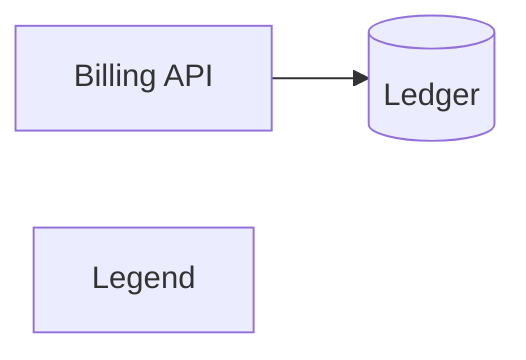

# 4. Mermaid is the structure source, mapped into slarti's own vocabulary

Date: 2026-10-24

## Status

Proposed

Supersedes invariant I8 of `docs/specs/slarti-project.md` and amends the non-goal
"Not pluggable".

## Context

LikeC4 owns the structure layer (§2.2 of the architecture). That choice has two
costs that only showed up once `slarti` was used outside its own repository.

**It adds a runtime.** LikeC4 is a Node package. A Python project that adopts
`slarti` now needs both Python and Node in CI, with pinned versions of each. Lua
projects need both and use neither. The tool that is meant to make architecture
cheap to keep honest makes it expensive to start.

**It picks a methodology.** LikeC4 is a C4 tool. Its elements are C4 elements and
its validation is C4 validation. A team that draws its architecture another way —
or that already has Mermaid diagrams in its docs — has to redraw the system in
LikeC4 before `slarti` can say anything about it.

Mermaid is already where most teams' diagrams live: it renders in GitHub, GitLab,
most doc sites and most editors, and it needs nothing installed to read. But
Mermaid diagrams carry little meaning on their own. A flowchart node is a label in
a box; nothing says whether it is a service, a database or a legend.

The spec's position until now (I8, "Not pluggable") was that `slarti` delegates all
parsing and supports exactly two backends. That position was right about adapters
— a registry of notation backends is the build system `slarti` refuses to become —
but it tied the structure layer to one methodology and one runtime.

## Decision

### 1. Vocabulary first

`slarti` defines its own vocabulary in LinkML, in two layers.

- **Structural layer — what a diagram says.** `Diagram`, `Node`, `Edge` and
  `SourceLocation` (file, line, Mermaid ID, label), with subclasses added per
  diagram type as each is supported (`Participant`/`Message`, `State`/`Transition`,
  …). It describes notation and nothing else. It knows no methodology.
- **Architectural layer — what the user means.** A base `Element` and `Relation`
  that projects extend in their own LinkML schema with whatever kinds they use.
  C4 becomes an optional profile schema that `slarti` ships and a project may
  import. Nothing in `slarti`'s checks assumes it.

The vocabulary ships with `slarti` and is versioned with it. It lands before any
parser, and the ownership seam (`OWN-*`) is re-expressed against `Element` rather
than LikeC4 containers.

### 2. Mermaid is the single structure source

`slarti` parses Mermaid into the structural layer. There is one structure source,
not an adapter per notation, so the spirit of I8 holds: no backend interface, no
registry of adapters.

Support is per diagram type and strict:

- Each supported type has a documented subset and a grammar in Python. No Node at
  runtime.
- Syntax outside the subset is a finding, not a silent skip. An unsupported diagram
  type is a finding unless the diagram is marked out of scope.
- The supported Mermaid version range is enforced, as I9 already requires for
  LikeC4 and LinkML.
- `slarti`'s own CI renders every fixture with mermaid-cli, so the subset is proven
  to be valid Mermaid. That Node dependency lives in `slarti`'s repository only.

### 3. Every diagram element gets a disposition

Each structural `Node` and `Edge` must be either **attached** to an architectural
element or **ignored with a reason**. There is no third state. This is the same
rule the registry applies to constraints: `enforced_by: none` is allowed, but only
with a reason.

Dispositions are written in native Mermaid wherever possible, so diagrams still
render unchanged:

- `class` assignments map nodes to element kinds (`class api,db billing`).
- `%% slarti:` directives cover what the syntax cannot: attach to a named element,
  ignore with a reason, declare an alias.

**Identity** across diagrams resolves on Mermaid IDs plus declared aliases. A
name that resolves to more than one element is a finding; `slarti` does not guess.

### 4. Dangling checks run in both directions (I14)

| Direction | Finding |
| --- | --- |
| Diagram → vocabulary | A node or edge with no disposition. |
| Diagram → vocabulary | An edge whose endpoint is ignored or unattached. |
| Diagram → vocabulary | A directive or alias naming an element that does not exist. |
| Vocabulary → diagram | An element that no diagram shows. Opt-in per element kind. |

Mermaid creates a node for any unknown name rather than rejecting it, so the first
check is the one LikeC4's `validate` used to provide. It is now `slarti`'s own, with
one fixture per direction.

### 5. LikeC4 becomes an input, not a backend

LikeC4 is no longer required. A project that keeps LikeC4 runs
`likec4 codegen mermaid` and points `slarti` at the output, so it flows through
the same single parser. How much meaning survives that codegen must be verified
before LikeC4 support is removed from `slarti` itself; until then, the existing
adapter stays behind an opt-in.

### 6. Rollout

Each phase ships with valid and invalid fixtures and is dogfooded on `slarti`'s
own architecture before the next begins.

1. Vocabulary: structural and architectural layers, the C4 profile, and the
   disposition rules, exercised with hand-written instances.
2. Flowchart.
3. Sequence.
4. State.
5. ER — checked against the LinkML schema it should agree with, which is a new
   seam rather than a duplicate of `gen-erdiagram`.

Phase 2 is done when `slarti`'s own architecture, ported from LikeC4 to Mermaid,
produces the same `slarti check` result as before the port.

## Consequences

- Adopting `slarti` needs `uv` and nothing else. Node leaves users' CI.
- Teams keep the diagrams and methodology they have. C4 is a profile, not the
  model.
- `slarti` now owns a parser. That is a real departure from "everything else is
  delegated", justified only because no Python parser exists and the Node runtime
  is the cost being removed. Mermaid's syntax moves, so the version gate and the
  rendering check in `slarti`'s CI are load-bearing.
- LikeC4's validation and views are no longer free. Dangling-relation detection
  must be rebuilt, and is (§4).
- Authors gain a small new burden: every node needs a disposition. That burden is
  the point — an undeclared box is exactly the drift `slarti` exists to surface.
- "Comprehensive Mermaid support" is reached one diagram type at a time. Types
  with no architectural content (pie, Gantt, journey) are never supported, only
  marked out of scope.

## Alternatives considered

- **Keep LikeC4 as the only structure source.** Rejected: the runtime and
  methodology costs above are the reason for this ADR.
- **Annotations only, no parser.** Rejected: without knowing which nodes a
  diagram contains, `slarti` cannot find the ones nobody annotated, which is the
  check that matters most.
- **One adapter per notation (Mermaid, PlantUML, Structurizr, …).** Rejected: it
  is the plugin system I8 exists to prevent. Other notations can reach `slarti`
  the way LikeC4 does, by generating Mermaid.
