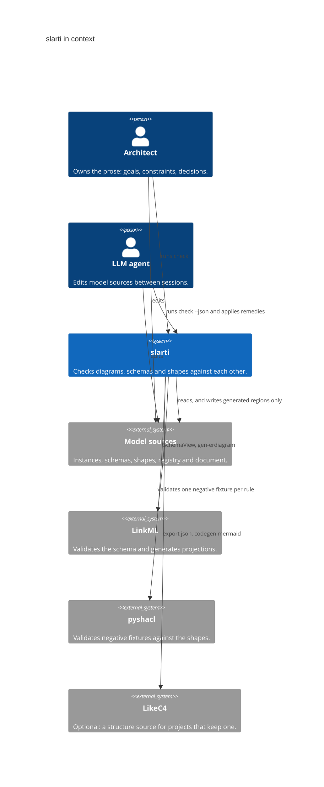
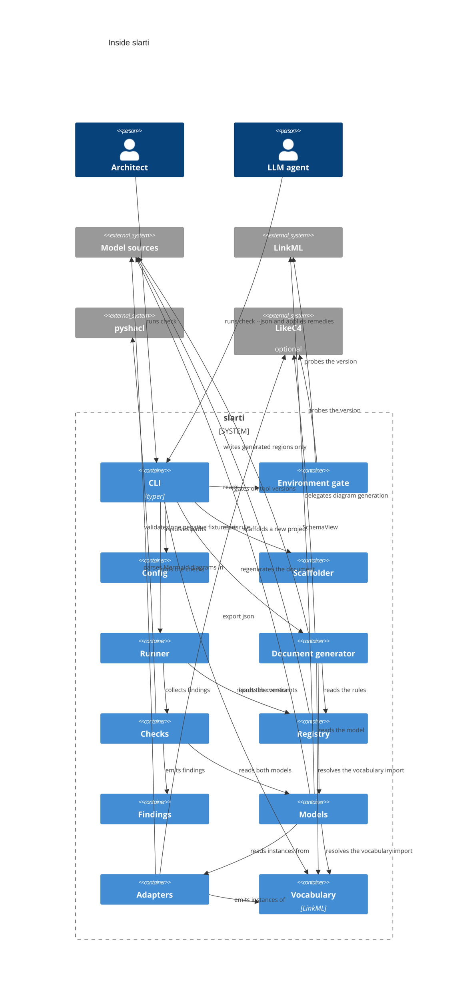
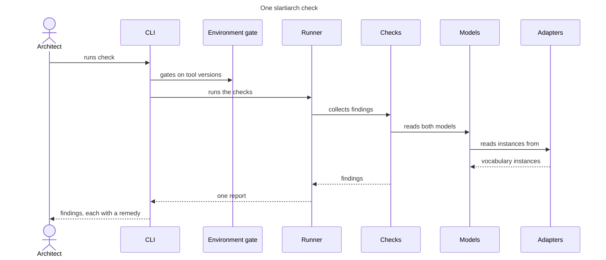
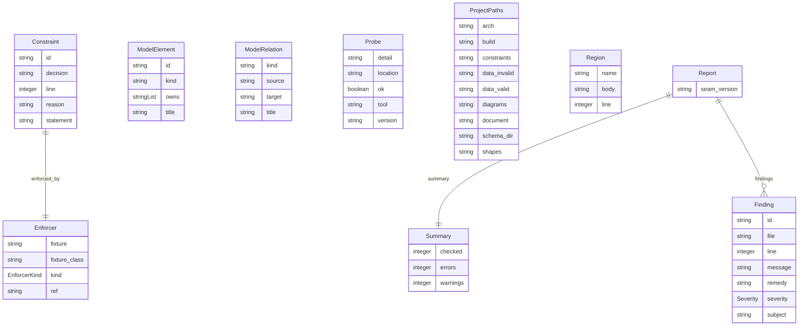

# slarti — architecture

This document is generated in part by `slarti` itself (I13). The prose is
user-authored; every region between `slarti:begin` / `slarti:end` markers is
generated from `docs/slarti/` and must never be hand-edited.

## 1. Introduction and goals

Architecture documents drift, and the drift is invisible: a stale diagram looks
exactly like a fresh one, and an unenforced rule in prose reads exactly like an
enforced one.

**Diagrams** — Mermaid in the document, or a LikeC4 model — say which components
exist and which talk to which. **LinkML** validates entities and generates schemas
and projections. Neither can see the other, and neither can see the prose document
that claims what they enforce. `slarti` owns exactly those joins:

- Architecture ↔ diagrams — every node and edge is attached or ignored (ADR-0004).
- Architecture ↔ LinkML — the ownership seam.
- Document ↔ rules — the constraint registry.
- Document ↔ models — the drift gate.

The architecture is `slarti`'s own vocabulary: elements and relations, written as
instances or produced by an adapter. Everything else — validating schemas and
shapes, generating projections — is delegated to LinkML and pyshacl as
subprocesses. The one thing `slarti` parses itself is the subset of Mermaid its
adapter reads.

## 2. Definitions

The rest of this document uses these words in a narrow sense. They are defined
here so that a rule, a table row and a finding all mean the same thing.

### 2.1 Layer

A **layer** is *the kind of model a rule can be stated against*, and therefore the
kind of tool that can decide it. Every constraint in the registry declares one, and
the layer determines which enforcer kinds are legal for it:

| Layer | Model | Answers | Decided by | Enforcer kinds |
| --- | --- | --- | --- | --- |
| 1 — structure | the vocabulary's elements and relations | Which components exist, and which may talk to which? | `slarti`'s diagram checks over the vocabulary instances | `likec4_element`, `likec4_relation`, `likec4_absent_relation`, `ownership` |
| 2 — schema | LinkML | What entities exist, and what shape is a single instance? | `linkml lint` / `linkml validate` | `linkml_class`, `linkml_slot` |
| 3 — instance | SHACL, run by pyshacl | Given real data, does this cross-field or cross-entity invariant hold? | `pyshacl` over a negative fixture | `shacl_shape` |
| none | — | Anything the three layers cannot see (runtime behaviour, code paths) | a test, or a human | `external`, or `enforced_by: none` with a reason |

The layers are ordered by what they can see, not by importance. Layer 1 can say
that the web container has no relation to the database; it cannot say that a field
is required. Layer 2 can say a slot is required; it cannot say that a subtask's list
matches its parent's. Layer 3 can say that; it cannot say anything about a code path
that never ran. A rule stated at the wrong layer is not enforced — it is only
mentioned — which is why `enforced_by: none` with a reason is a first-class answer.

### 2.2 The vocabulary — the structure layer

`slarti`'s own LinkML vocabulary owns *the boxes and arrows*: elements, relations,
and the diagrams that depict them (ADR-0004).

- **Responsibilities.** Say which elements exist and which relations hold between
  them, and record every diagram's nodes and edges with the element or relation
  each depicts, or why it depicts nothing. `slarti`'s diagram checks (`ATTACH-*`,
  `IDENT-*`, `DANGLE-*`, `KIND-1`) run on these instances.
- **Not responsible for.** Anything about an instance of data. The vocabulary has no
  notion of a field, a type or a cardinality in the system it describes.
- **How `slarti` uses it.** `slarti`'s own elements and relations are written by
  hand in `docs/slarti/instances/`, with kinds from the C4 profile. The diagrams in
  this document are Mermaid, read back by the Mermaid adapter: a C4 macro attaches
  its node to the element its alias names, and a `Rel` label names the relation it
  depicts. A diagram that drifts from the instances is a finding.
- **LikeC4 instead.** A project may keep a LikeC4 model. The LikeC4 adapter, the
  only component that shells out to it (D5, D6), translates `likec4 export json`
  into the same instances, and `likec4 codegen mermaid` produces the diagrams the
  document generator injects (D9). Node and LikeC4 are needed only then.

### 2.3 LinkML — the schema layer

LinkML owns *the entities*: classes, slots, types, cardinality, and the generators
that project them.

- **Responsibilities.** Validate `docs/slarti/linkml/*.yaml`; resolve it as a `SchemaView`;
  generate SHACL (`gen-shacl`), ER diagrams, and implementation projections
  (`gen-pydantic`, `gen-typescript`, `gen-sqlddl`, `gen-json-schema`); convert YAML
  fixtures to RDF (`linkml-convert`).
- **Not responsible for.** Where an entity lives in the deployed system, and any
  invariant that spans two instances.
- **How `slarti` uses it.** The adapters read the `SchemaView` for the class list and
  the owner annotation on each class; layer-2 enforcers resolve against it.

### 2.4 pyshacl — the instance layer

pyshacl owns *the verdict on real data*: it runs a SHACL shapes graph against a data
graph and reports conformance.

- **Responsibilities.** Given the merged shapes (`docs/slarti/shacl/*.ttl`, plus anything
  LinkML generated) and one fixture, decide conformance and name every violated
  shape.
- **Not responsible for.** Deciding which fixtures exist or what they prove — that is
  the registry's job.
- **How `slarti` uses it.** Every layer-3 rule declares one negative fixture in
  `docs/slarti/data/invalid/`. `slarti check` asserts the fixture *fails* and that the
  violation report *names that rule's shape* (`REG-6`, `REG-7`). A shape that stops
  firing is a finding, not a silently passing build.

### 2.5 Enforcer

The named thing that decides a rule: a shape IRI, a `Class.slot`, a relation between
two elements, or an ownership pair. A constraint without a resolvable enforcer is a `REG-1`
finding.

### 2.6 Seam

A join between two models that neither model can see: architecture ↔ diagrams,
architecture ↔ LinkML (ownership), document ↔ registry, document ↔ models. Seams are the only thing `slarti` itself
enforces.

## 3. Constraints

- Python 3.11+, distributed as a `uv`-installable CLI.
- `slarti` checks instances of its own vocabulary (ADR-0004). The built-in LikeC4
  and Mermaid adapters produce them, and so may any other tool. No plugin API.
- No cache and no state file: everything is derived on each invocation.
- No JVM, no Docker, no browser and no Node on the default path. Node is needed
  only by a project that keeps a LikeC4 model.
- Supported ranges are enforced at runtime: LinkML `>=1.11,<2`, Python
  `>=3.11,<4`, a pinned Mermaid `>=11,<13`, and, only when the project keeps a
  LikeC4 model, LikeC4 `>=1.59,<2` and Node `>=20`. Outside the range `slarti`
  refuses to run rather than producing possibly-wrong output.

## 4. Context

The people who use `slarti`, the sources they edit, and the tools it delegates to.
This diagram is hand-written. The Mermaid adapter reads it back, so every box is
attached to an element in `docs/slarti/instances/`. An arrow to or from `slarti`
depicts the relation of the same name to or from one of its containers (`DANGLE-2`
rolls it up); the arrows that summarise several relations are ignored with a reason.

## 5. Building block view

Inside `slarti`: the CLI gates on the environment, the runner orders the checks,
the adapters are the only components that read diagrams, and the document generator
is the only component that writes. Every `Rel` is a relation the instances declare
(`DANGLE-2`), so this diagram cannot drift from the model.

### 5.1 One `slartiarch check`

A hand-written diagram, read back by the Mermaid adapter: every participant is
attached to the container it depicts, and every call must be a relation the model
declares, so this diagram cannot drift from the containers view above.

## 6. The ownership seam

Every entity in the schema names the architectural element that owns it, and every
element claims its entities back. The check reads vocabulary `Element` instances, so
it holds the same for LikeC4, hand-written instances or any other producer. Both directions are checked (`OWN-1`..`OWN-5`), because
a dangling pointer and an unclaimed target are different failures.

<!-- slarti:begin ownership -->

| Entity | Owner | Owner title |
| --- | --- | --- |
| Constraint | `slarti.registry` | Registry |
| Enforcer | `slarti.registry` | Registry |
| Finding | `slarti.findings` | Findings |
| ModelElement | `slarti.models` | Models |
| ModelRelation | `slarti.models` | Models |
| Probe | `slarti.env` | Environment gate |
| ProjectPaths | `slarti.settings` | Config |
| Region | `slarti.docsgen` | Document generator |
| Report | `slarti.findings` | Findings |
| Summary | `slarti.findings` | Findings |

<!-- slarti:end ownership -->

## 7. Schema entities

The entities `slarti` reasons about, and how they relate to each other, as derived
from the LinkML schema.

<!-- slarti:begin linkml_erd -->

<!-- slarti:end linkml_erd -->

## 8. Enforced rules

Each rule below points at an enforcer that `slarti` resolves against the models on
every run. If the enforcer disappears, the rule becomes a `REG-1` finding rather
than a sentence that quietly stops being true.

<!-- slarti:begin constraints -->

| ID | Rule | Enforced by | Decision |
| --- | --- | --- | --- |
| D1 | Every finding carries a stable rule ID and a remedy sentence. | shacl_shape `slarti:FindingCarriesRemedy` | ADR-0002 |
| D2 | A constraint with no enforcer must give a reason. | shacl_shape `slarti:UnenforcedConstraintGivesReason` | ADR-0002 |
| D3 | An enforcer names the thing that enforces the rule. | shacl_shape `slarti:EnforcerNamesWhatItIs` | - |
| D4 | A finding names the file it is about. | linkml_slot `Finding.file` | - |
| D5 | The checks never invoke LikeC4 or LinkML themselves; the adapters do. | likec4_absent_relation `slarti.checks -> likec4` | - |
| D6 | The CLI never reads model sources directly; it goes through the adapters. | likec4_absent_relation `slarti.cli -> sources` | - |
| D7 | The environment gate probes LikeC4 before any command that shells out to it. | likec4_relation `slarti.env -> likec4` | - |
| D8 | Every domain entity is owned by exactly one container. | ownership `Finding` | ADR-0002 |
| D9 | The document generator writes only generated regions of the sources. | likec4_relation `slarti.docsgen -> sources` | - |

<!-- slarti:end constraints -->

## 9. Unverified invariants

Rules that are stated but not mechanically enforced. This table is the honest
case, not a failure: each entry must say why enforcement is not possible.

<!-- slarti:begin unverified -->

| ID | Rule | Why unenforced |
| --- | --- | --- |
| U1 | slarti never modifies a user-authored file. | Layer 1 can say which container writes to the sources, not that the write touched only a generated region. Verified instead by a test that hashes every user-authored file before and after each command. |
| U2 | Running a delegated tool directly produces the same result as running it via slarti. | No model can assert that a subprocess was passed through unaltered. Verified by a test asserting byte-identical diagnostics. |
| U3 | Generation is idempotent — running slartiarch check --fix twice produces identical output. | Idempotence is a property of a run, not of the model. Verified by a test that hashes the tree across two runs. |
| U4 | The Python interfaces the implementation uses are generated from the schema. | No model can assert that a module imports a generated projection rather than a copy of it. Verified instead by a test that regenerates slarti/domain.py from docs/slarti/linkml/slarti.yaml and fails if the committed file differs. |

<!-- slarti:end unverified -->

## 10. Decisions

- **ADR-0001 — Python project.** See `docs/adr/0001-python-project.md`.
- **ADR-0002 — Findings are the interface.** See
  `docs/adr/0002-findings-are-the-interface.md`. Findings, not exit codes, are how
  `slarti` speaks to both humans and agents. Every finding carries a stable rule
  ID, a file, a subject phrased in domain terms, and a remedy sentence; the same
  findings render as text or as JSON. Entities in the registry and the schema are
  shaped around that contract, which is why `Finding`, `Constraint` and `Enforcer`
  are modelled entities with shapes over them.
- **ADR-0003 — The Python interfaces are a LinkML projection.** See
  `docs/adr/0003-python-interfaces-are-a-linkml-projection.md`. The domain classes
  the implementation uses are generated from `docs/slarti/linkml/slarti.yaml` by
  `gen-pydantic` into `slarti/domain.py` and committed; behaviour is hand-written
  around them. Two definitions of one entity is the drift `slarti` exists to catch,
  so the schema is the only one, and a stale projection fails the test suite.
- **ADR-0004 — slarti owns its vocabulary; diagrams arrive through adapters.** See
  `docs/adr/0004-slarti-owns-its-vocabulary.md`. Checks run on instances of
  `slarti`'s own LinkML vocabulary, never on diagram syntax. LikeC4 and Mermaid are
  built-in adapters, and any tool that writes the instances is an equally valid
  producer. `slarti` itself keeps its elements and relations as instances and
  draws them in Mermaid, so its default path needs no Node. That is also why the
  domain classes are named `ModelElement` and `ModelRelation`: the schema imports
  the vocabulary's own `Element` and `Relation`.
- **ADR-0005 — One command checks the document.** See
  `docs/adr/0005-one-command-checks-the-document.md`. `slarti check` reports every
  finding, the document's included; `slarti check --fix` regenerates the generated
  regions first. Diagrams are no longer committed as separate files.

## 11. Risks and technical debt

- Upstream churn in LikeC4's JSON export or LinkML's generators would produce
  wrong findings. Mitigated by a hard version ceiling and a loud refusal to run.
- Mermaid's syntax moves, and `slarti` owns the parser that reads it. Mitigated by
  a supported range and by rendering every fixture, and this document, with the
  pinned mermaid-cli in CI.
- The enforcer kinds `likec4_element`, `likec4_relation` and
  `likec4_absent_relation` keep their names, although they resolve against the
  vocabulary whatever produced it.
- The registry becomes busywork if it ever stops generating these tables.
- YAML fixtures require a declared `fixture_class` to be converted to RDF;
  Turtle fixtures need nothing. Both are accepted.
