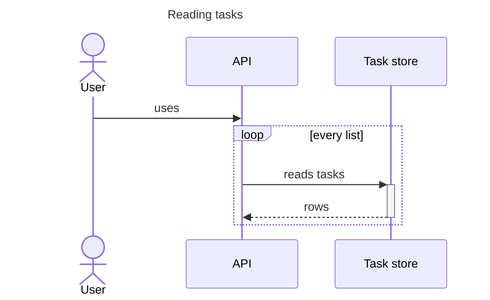
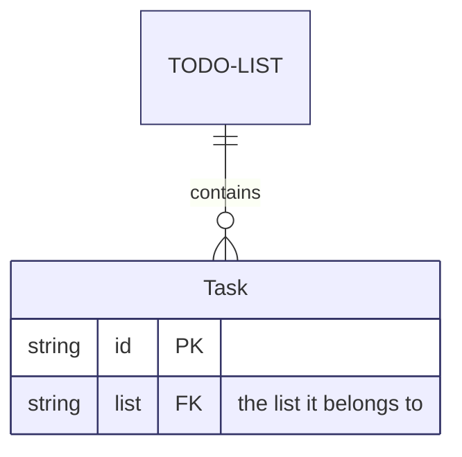

# The Mermaid adapter

`slarti` reads Mermaid diagrams with a parser of its own, written in Python, so a
project that keeps its diagrams in Mermaid needs `uv` and nothing else: no Node and
no Mermaid install. The adapter turns each diagram into instances of the vocabulary
(see [producers.md](producers.md)), and every check then runs on those instances.

It reads a **subset** of Mermaid, one diagram type at a time. Anything outside the
subset is a finding, never a silent skip, so a diagram `slarti` cannot read never
looks like a diagram that passed.

## Configure the inputs

Name Markdown files, `.mmd` files, or directories of either under `mermaid`:

```toml
# slarti.toml (or [tool.slartiarch.paths] in pyproject.toml)
[paths]
mermaid = ["docs/architecture.md", "docs/diagrams-src"]
```

- A `.mmd` or `.mermaid` file is one diagram. Its id is the file's path.
- A Markdown file contributes every ` ```mermaid ` or `~~~mermaid` fence. The
  diagrams are numbered in order: `docs/architecture.md#1`, `#2`, …
- A directory contributes every `*.mmd`, `*.mermaid`, `*.md` and `*.markdown`
  file beneath it.
- Fences inside a `<!-- slarti:begin … -->` / `<!-- slarti:end … -->` region are
  never read. `slartiarch check --fix` generated them from the model, so reading them back
  would check the model against itself.

A node's id is its diagram's id, a `/`, and the name the diagram gives it:
`docs/architecture.md#1/cli`. Every node and edge carries a `SourceLocation` whose
`line` is the line of the file it was first drawn on.

## Dispositions

Every node and edge must be **attached** to what it depicts or **ignored with a
reason** (`ATTACH-*`). Mermaid says this in two ways, and neither changes how the
diagram renders.

**Classes**, where the diagram type has them. A node assigned a class (`A:::Service`,
or `class A Service`) is attached to the element its own name resolves to, and the
class is the kind that element must be (`KIND-1`). With a project schema, a class
also matches every kind beneath it.

**Directives**: `%% slarti:` comments, which Mermaid ignores.

| Directive | Meaning |
| --- | --- |
| `%% slarti: attach <node> <element>` | The node depicts the element (an id or alias). |
| `%% slarti: ignore <node> <reason>` | The node depicts nothing in the architecture. |
| `%% slarti: alias <name> <element>` | In this diagram, the name stands for the element wherever a node is attached by its own name. |
| `%% slarti: attach <source> -> <target> <relation>` | Every edge from source to target depicts the relation. |
| `%% slarti: ignore <source> -> <target> <reason>` | Every edge from source to target depicts nothing. |
| `%% slarti: ignore * <reason>` | Every node and edge that nothing else disposes of depicts nothing. |

Write the spaces around `->`. A directive goes anywhere inside the diagram.

The adapter decides each disposition in this order:

- **Node:** a directive, then its classes, then `ignore *`. A node with none of
  these has no disposition (`ATTACH-1`).
- **Edge:** a directive. Then, if either end is ignored, the edge is ignored too,
  since it cannot depict a relation between elements. Then its label, which names
  the relation it depicts (`DANGLE-2` checks that the architecture declares it).
  Then `ignore *`. An unlabelled edge with none of these has no disposition.

A directive that is malformed, or that names a node or edge the diagram does not
draw, is `MMD-4`.

## Sequence diagrams

Participants become `Participant` nodes; messages become `Message` edges, with
their `order` in the diagram (from 1, counted through every block) and their
`arrow` as written.



Supported:

| Construct | Syntax |
| --- | --- |
| Header | `sequenceDiagram` |
| Participants | `participant <id>`, `participant <id> as <label>`, `actor <id>`, `actor <id> as <label>`, or first use in a message or note |
| Messages | `<id><arrow><id>: <text>`, with arrows `->`, `-->`, `->>`, `-->>`, `-x`, `--x`, `-)`, `--)`, optionally followed by `+` or `-` |
| Notes | `Note left of <id>: <text>`, `Note right of <id>: <text>`, `Note over <id>[,<id>]: <text>` |
| Blocks | `loop`, `opt`, `break`, `rect`, `alt`/`else`, `par`/`and`, `critical`/`option`, each closed by `end` |
| Other | `activate <id>`, `deactivate <id>`, `autonumber`, `title <text>` or `title: <text>` |

An id starts with a letter or `_` and holds letters, digits, `_` and `.`. Message
and note text runs to the end of the line and holds no `;` or `#`.

Not supported, each a finding: `box`, `create` and `destroy`, `link` and `links`,
participant types written `@{ … }`, bidirectional arrows (`<<->>`), several
statements on one line (`;`), and entity codes (`#35;`).

## Entity-relationship diagrams

Entities become `Entity` nodes, with their `attributes`; relationships become
`EntityRelationship` edges, with the `source_cardinality` and `target_cardinality`
at each end and whether the relationship is `identifying` (a solid line).



Supported:

| Construct | Syntax |
| --- | --- |
| Header | `erDiagram` |
| Entities | `<name>`, `<name>[<label>]`, `<name>["<label>"]`, optionally followed by `:::<class>`, or first use in a relationship |
| Attributes | `<name> { … }` with one `<type> <name> [PK\|FK\|UK[, …]] ["<comment>"]` per line; `{ }` is an empty entity |
| Relationships | `<name> <left><line><right> <name> : <label>`, where the label is one word or `"quoted"` (`""` is no label) |
| Cardinality | left `\|o`, `\|\|`, `}o`, `}\|`; right `o\|`, `\|\|`, `o{`, `\|{`; line `--` (identifying) or `..` |
| Classes | `class <name>[,<name>…] <class>`, `classDef <class>[,<class>…] <styles>` |
| Other | `style <name>[,<name>…] <styles>`, `direction TB\|BT\|LR\|RL` |

A name starts with a letter or `_` and holds letters, digits, `_` and `-`.

Not supported, each a finding: quoted entity names, written cardinalities
(`one or more`, `zero or one`, …), numeric cardinalities, and unquoted labels of
more than one word.

## Other diagram types

Any other type (`flowchart`, `classDiagram`, `stateDiagram`, `C4Context`, …) is
`MMD-2`. Draw it as a supported type, or keep it out of the configured inputs.
More types are added one at a time.

## Findings

| ID | Meaning |
| --- | --- |
| `MMD-1` | A configured Mermaid input does not exist. |
| `MMD-2` | A diagram is of a type `slarti` cannot read, or declares no type. |
| `MMD-3` | A line is outside the supported subset of its diagram type. The finding names the line. |
| `MMD-4` | A `%% slarti:` directive is malformed, or names a node or edge the diagram does not draw. |
| `KIND-1` | A node's class names a kind its element is not. |

A diagram with an `MMD-2` or `MMD-3` finding contributes no nodes or edges. The
rest of the run goes on: the other diagrams are still checked.

## Supported Mermaid versions

The supported range is Mermaid `>=11,<13`. `slarti`'s own CI renders every
fixture, and the examples on this page, with the mermaid-cli it pins (Mermaid 12),
to prove that what the adapter accepts is Mermaid that renders.

`slarti` runs no Mermaid of its own. A project that pins Mermaid for rendering
(`node_modules/mermaid`) must pin a supported version: `slartiarch doctor` reports
it, and `slartiarch check` refuses to run outside the range (`ENV-1`), as it does
for every other tool. A project that pins none, rendering in GitHub for instance,
is not gated.
