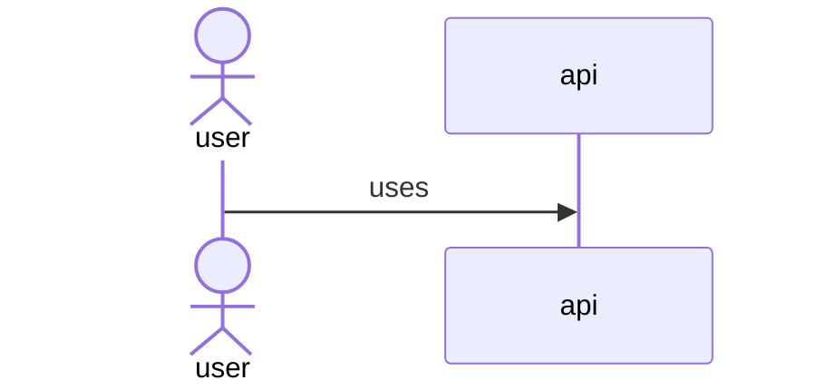
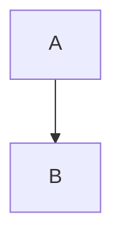

# A document with diagrams

Prose before the diagram.



Generated regions are slartiarch's own output and are never read back:

<!-- slarti:begin diagram:index -->



<!-- slarti:end diagram:index -->

~~~mermaid
erDiagram
  %% slarti: ignore * the domain model, which the LinkML schema checks
  TASK
~~~

```python
print("not a diagram")
```
